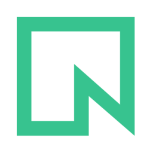

<p align="center">
  
</p>

<h1 align="center">picgo-plugin-neon</h1>

<p align="center">A <a href="https://github.com/PicGo/PicGo">PicGo</a> uploader for <a href="https://neon.com/docs/storage/overview">Neon Object Storage</a>.</p>

Neon Object Storage is S3-compatible storage that branches with your Neon Postgres database. This plugin uploads images from PicGo (GUI and CLI) into a Neon bucket and copies a public link to your clipboard.

[中文说明](#中文说明)

## Features

- Uploads to any Neon bucket over the S3 API
- Public links that open without signing, straight from the bucket or through your own CDN domain
- Object key templates with date, hash, UUID and file name variables
- Optional sync delete: removing an image from the PicGo album also removes it from Neon
- Respects the proxy set in PicGo
- English, 简体中文, 繁體中文, 日本語 and 한국어 labels

## Requirements

- PicGo 3.x, or PicGo-Core 3.x for the CLI
- A Neon project in a region with Object Storage: `aws-us-east-1`, `aws-us-east-2`, `aws-eu-central-1` or `aws-ap-southeast-1`

## Set up Neon

You need four values: the branch S3 endpoint, a bucket, an access key ID and a secret access key. The commands below use the [Neon CLI](https://neon.com/docs/reference/neon-cli). Everything can also be done in the Neon Console.

**1. Create a public bucket.** PicGo hands out plain links, so the bucket must allow anonymous reads:

```bash
neon buckets create images --access-level public_read --project-id <project_id> --branch <branch>
```

**2. Create a storage credential:**

```bash
neon credentials create --name picgo --scope storage:read --scope storage:write --project-id <project_id> --branch <branch>
```

The output has a `token_id` (your **access key ID**, starts with `nak_`) and an `s3_secret_access_key` (your **secret access key**). Save the secret, it is shown only once.

**3. Find the branch S3 endpoint.** It looks like `https://br-xxx.storage.c-5.us-east-2.aws.neon.tech`. The Console shows it on the branch's storage page, or ask the API:

```bash
neon api --method GET /projects/<project_id>/branches/<branch_id>/storage -o json
```

Use the `s3_endpoint` field.

> Buckets and endpoints belong to a single branch. Point PicGo at the branch you treat as production. Child branches inherit its objects, but uploads on a child never show up in the parent.

## Install

**GUI:** open **Plugins**, search for `neon`, and install **picgo-plugin-neon**. Then pick **Neon Object Storage** under **Uploaders** and fill in the settings.

**CLI:**

```bash
picgo install neon
picgo set uploader neon
picgo use uploader neon
```

## Settings

| Setting | Required | Description |
| --- | --- | --- |
| S3 endpoint | Yes | Branch S3 endpoint, for example `https://br-xxx.storage.c-5.us-east-2.aws.neon.tech` |
| Bucket | Yes | Bucket name, for example `images` |
| Access key ID | Yes | Credential `token_id` |
| Secret access key | Yes | Credential `s3_secret_access_key` |
| Path | No | Object key template. Default `{year}/{month}/{md5}.{extName}` |
| Custom URL | No | CDN or custom domain in front of the bucket. Links become `<custom URL>/<key>` |
| Sync delete | No | Delete the object from Neon when it is deleted from the PicGo album. Off by default |

Path variables:

| Variable | Example |
| --- | --- |
| `{year}` `{month}` `{day}` | `2026` `01` `05` |
| `{hour}` `{minute}` `{second}` `{millisecond}` | `07` `08` `09` `010` |
| `{timestamp}` | `1767596889010` |
| `{md5}` `{sha256}` | Hash of the file contents |
| `{uuid}` | Random UUID |
| `{fileName}` `{extName}` | `cat` `png` |

Without a custom URL, links look like:

```
https://br-xxx.storage.c-5.us-east-2.aws.neon.tech/images/2026/01/5d41402abc4b2a76b9719d911017c592.png
```

## Serving through a CDN

For images that get a lot of traffic, put a CDN such as Cloudflare in front of the bucket and set **Custom URL** to the CDN domain. Hash-based keys like `{md5}` change whenever the image changes, so the CDN can cache them for a long time.

## Troubleshooting

- **`NotImplemented` / 501:** another tool sent an S3 ACL. Neon sets access on the bucket, not per object. This plugin never sends ACLs.
- **Uploads work but links return `403 AccessDenied`:** the bucket is `private`. Set it to `public_read` in the Neon Console or API.
- **`NoSuchBucket`:** the bucket does not exist on the branch behind your endpoint. Buckets are per branch.
- **`InvalidAccessKeyId`:** the access key ID must be the full `token_id`, not `token_id_short`.
- **`SignatureDoesNotMatch`:** the secret must be `s3_secret_access_key`, not `api_token`.
- **Upload returns `AccessDenied`:** the credential lacks `storage:write`, or it was issued on a branch that is not this branch or one of its ancestors.

More in the [Neon storage troubleshooting guide](https://neon.com/docs/storage/troubleshooting).

## Development

```bash
pnpm install
pnpm test       # builds with tsc, then runs vitest against a local fake S3 server
pnpm test:live  # same plugin, against a real Neon branch
```

`test:live` reads `.env.test` through [dotenvx](https://dotenvx.com). Copy `.env.example` to `.env.test` and fill in a branch endpoint, a `public_read` bucket, a read/write credential and, optionally, a `private` bucket and a read-only credential for the access-denied cases. Each run writes under its own `live/<run id>/` prefix and deletes everything it created.

## 中文说明

本插件为 PicGo 添加 **Neon 对象存储** 图床。Neon 对象存储兼容 S3，并会随 Neon Postgres 数据库的分支一起分支。

1. 在支持对象存储的区域（`aws-us-east-1`、`aws-us-east-2`、`aws-eu-central-1`、`aws-ap-southeast-1`）创建 Neon 项目。
2. 创建 `public_read` 存储桶：`neon buckets create images --access-level public_read`
3. 创建凭证：`neon credentials create --name picgo --scope storage:read --scope storage:write`。`token_id` 即访问密钥 ID，`s3_secret_access_key` 即访问密钥。
4. 在控制台或通过 `neon api --method GET /projects/<project_id>/branches/<branch_id>/storage` 获取 `s3_endpoint`。
5. 在 PicGo 插件设置中搜索 `neon` 并安装，然后在图床设置中选择 **Neon 对象存储** 并填写以上信息。

## License

[MIT](./LICENSE)
